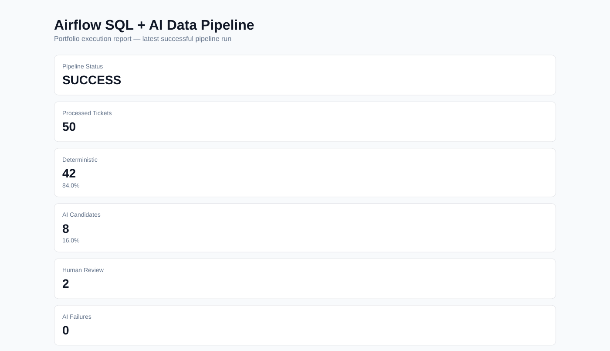
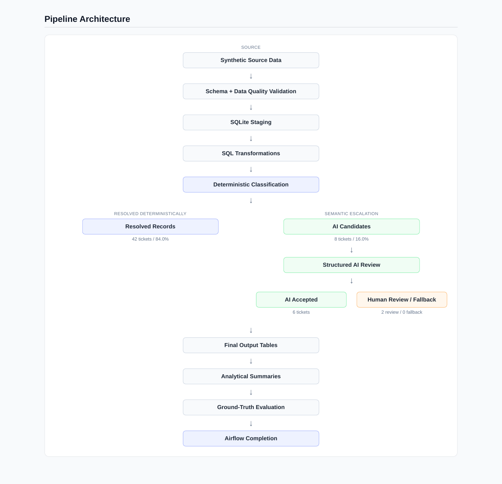

# Airflow SQL + AI Data Pipeline

A production-style data pipeline that demonstrates how **Apache Airflow, SQL, Python, SQLite, deterministic validation, and selective AI enrichment** can work together without making generative AI responsible for core data-engineering logic.

The project uses synthetic employee-support ticket data and follows a deterministic-first engineering principle:

> **Use Airflow to orchestrate the workflow, SQL/Python to perform deterministic processing and validation, and AI only where semantic interpretation adds value.**

---

## Portfolio Highlights

The latest validated pipeline run processed **50 synthetic tickets**:

| Metric | Result |
|---|---:|
| Pipeline status | SUCCESS |
| Source records | 50 |
| Clean records | 50 |
| Deterministically resolved | 42 |
| Deterministic rate | 84% |
| AI candidates | 8 |
| AI escalation rate | 16% |
| AI results accepted | 6 |
| Human-review cases | 2 |
| AI failures | 0 |
| Final mismatches | 0 |
| Automated tests | 20 / 20 passed |

The pipeline intentionally avoids sending every record to AI. Only **8 of 50 records** required semantic enrichment.



---

# Architecture



```text
Synthetic Source Data
        |
        v
Schema / Data Quality Validation
        |
        v
SQLite Staging Tables
        |
        v
SQL Transformations
        |
        v
Deterministic Classification
        |
        +-------------------------+
        |                         |
        v                         v
Resolved Records            AI Candidates
                                  |
                                  v
                         Structured AI Review
                                  |
                      +-----------+-----------+
                      |                       |
                      v                       v
                 AI Accepted             Human Review
                                             /
                                          Fallback
                      |                       |
                      +-----------+-----------+
                                  |
                                  v
                         Final Output Tables
                                  |
                                  v
                        Analytical Summaries
                                  |
                                  v
                      Ground-Truth Evaluation
                                  |
                                  v
                         Airflow Completion